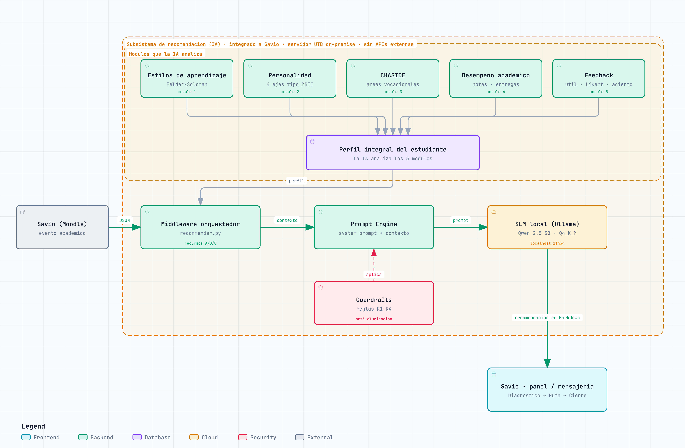

# docs/arquitectura — Arquitectura del subsistema

Arquitectura del subsistema de recomendacion adaptativa (IA) integrado a Savio (Moodle).

> 📌 Documentacion del sprint: [docs/entregas/entrega-1-poc-funcional/sprint-4-benchmarks.md](../entregas/entrega-1-poc-funcional/sprint-4-benchmarks.md) (Issue #11)



## Como funciona

1. **Savio (Moodle)** envia un evento academico (nota, entrega, inactividad) en JSON.
2. La **IA** se integra a Savio y contiene los modulos que analiza para formar el **perfil integral del estudiante**:

   | Modulo | Que aporta |
   |---|---|
   | 1. Estilos de aprendizaje | Como prefiere aprender (Felder-Soloman) |
   | 2. Personalidad | Rasgos conductuales (4 ejes tipo MBTI) |
   | 3. CHASIDE | Areas vocacionales para analogias contextuales |
   | 4. Desempeno academico | Notas y entregas del curso |
   | 5. Feedback | Si la recomendacion fue util (util, Likert, tasa de acierto) |

3. El **Middleware orquestador** (`recommender.py`) junta el evento, el perfil y los recursos A/B/C.
4. El **Prompt Engine** arma el prompt con el system prompt, el refuerzo y el contexto, aplicando los **guardrails**: R1 solo la materia, R2 nunca soluciones completas, R3 tono empatico, R4 estructura fija en Markdown, sin URLs ni autores.
5. El **SLM local** (Ollama, Qwen 2.5 3B Q4_K_M en `localhost:11434`) genera la recomendacion.
6. La recomendacion vuelve al **panel o la mensajeria de Savio**: Diagnostico → Ruta → Recursos → Cierre.

Todo corre en el servidor UTB on-premise, sin APIs externas: los datos del estudiante no salen del campus.

## Archivos

| Archivo | Contenido |
|---|---|
| [`arquitectura-savio-ia.html`](arquitectura-savio-ia.html) | Diagrama interactivo (tema claro/oscuro, zoom, vistas guiadas, exportacion PNG/SVG). Abrirlo en el navegador. |
| [`arquitectura-savio-ia.png`](arquitectura-savio-ia.png) | Imagen del diagrama para presentaciones e informes, exportada desde el HTML |
| [`arquitectura-savio-ia.architecture.json`](arquitectura-savio-ia.architecture.json) | Especificacion fuente del diagrama (se edita esta, no el HTML) |

## Regenerar

Hecho con la skill `archify` (`skills/archify/`). Despues de editar el `.json`, desde `skills/archify/`:

```bash
node bin/archify.mjs validate architecture ../../docs/arquitectura/arquitectura-savio-ia.architecture.json --quality showcase
node bin/archify.mjs deliver architecture ../../docs/arquitectura/arquitectura-savio-ia.architecture.json ../../docs/arquitectura/arquitectura-savio-ia.html --quality showcase
```

Luego actualizar `arquitectura-savio-ia.png`: abrir el HTML y usar **Export → PNG** (guardarlo con ese nombre en esta carpeta).
