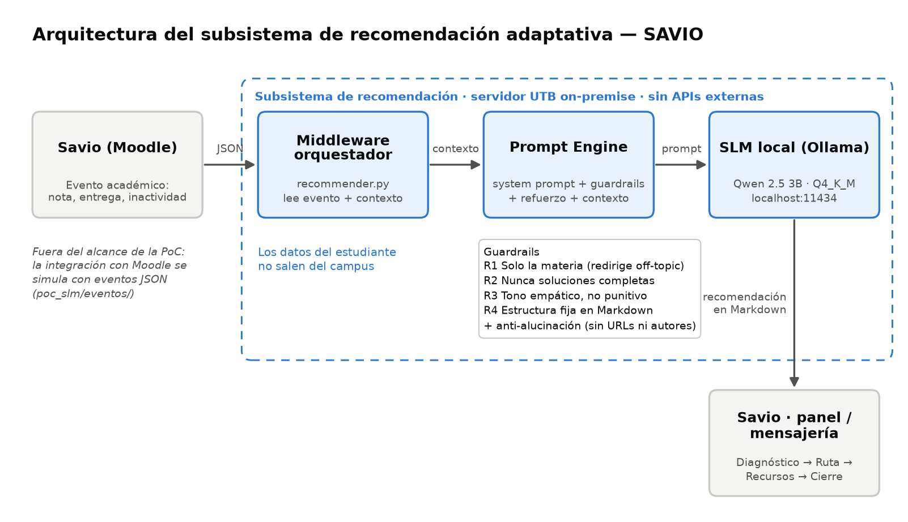

# docs/arquitectura — Diagramas del subsistema

Diagramas de arquitectura, flujo de datos e integración con Savio (Moodle).

> 📌 Documentación del sprint: [docs/entregas/entrega-1-poc-funcional/sprint-4-benchmarks.md](../entregas/entrega-1-poc-funcional/sprint-4-benchmarks.md) (Issue #11)

## Flujo de datos del subsistema (diseño)

```
┌─────────────┐   evento (nota, entrega, inactividad)
│ Savio/Moodle│──────────────┐
└─────────────┘              ▼
                     ┌───────────────┐   consulta: nota, tema,
                     │  Middleware / │   estilo de aprendizaje
                     │  Orquestador  │
                     └───────┬───────┘
                             ▼
                     ┌───────────────┐   system prompt + guardrails
                     │ Prompt Engine │   + contexto del estudiante
                     └───────┬───────┘
                             ▼
                     ┌───────────────┐   inferencia local
                     │  SLM (Ollama) │   sin APIs externas
                     └───────┬───────┘
                             ▼
                     ┌───────────────┐
                     │ Panel Savio / │   recomendación personalizada
                     │  Mensajería   │
                     └───────────────┘
```

## Diagrama exportado (Issue #11)



- Archivos: [`arquitectura-subsistema.svg`](arquitectura-subsistema.svg) (vectorial) y [`arquitectura-subsistema.png`](arquitectura-subsistema.png).
- Generado con [`generar_diagrama.py`](generar_diagrama.py) (`python docs/arquitectura/generar_diagrama.py`).
- Usado en la diapositiva 8 de la [presentación técnica](../presentacion/README.md).
